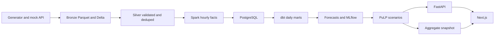

# Hospital Operations Intelligence

HOICO is a local planning system for a synthetic community hospital. It forecasts arrivals, estimates bed pressure, and compares staffing and bed scenarios with the constraints written next to the result. It is a portfolio project. It is not a clinical system, and the numbers are not evidence about a real hospital.

## Status

The local path is the product: synthetic data, a PySpark medallion lake, PostgreSQL, dbt, forecasts with a baseline, MLflow, a constrained scenario model, FastAPI, and this Next.js console. Airflow orchestrates the same commands.

Optional and free if you already have the accounts: a Databricks Free Edition serverless job, and a Vercel Hobby deploy of the aggregate snapshot. Neither is required to run the demo. This repo does not use a Databricks commercial trial or any hosted database that needs a credit card.

## Architecture



| Piece | Role |
| --- | --- |
| Python generator | Seeded synthetic encounters, capacity, staffing, discharges, events |
| PySpark | Bronze, Silver, and Gold Parquet plus local Delta |
| PostgreSQL 16 | Reference data and serving tables |
| dbt Core | Daily arrivals, pressure bands, quarantine counts, tests |
| statsmodels, LightGBM | Holt-Winters and a feature model, chosen on a validation window |
| Seasonal naive | Baseline on the same chronological test window |
| MLflow | Local file store for parameters and metrics |
| PuLP CBC | Seven-day ward plan with a do-nothing baseline |
| FastAPI | Read API and scenario comparison |
| Next.js | Operations console |
| Airflow 2.10 | DAG over the same CLI, in the `full` Compose profile |
| Databricks Free Edition | Optional serverless Delta job |
| Vercel Hobby | Optional static snapshot hosting |

Not in this repo: Kafka, geospatial analysis, Terraform, a paid warehouse, and a hosted API.

## Quick start

Docker Desktop needs about 8 GB of memory for the full profile. The core profile is Postgres, one pipeline run, the API, and the console.

```bash
docker compose -f infra/docker-compose.yml --profile core up --build
```

Then open [http://localhost:3000](http://localhost:3000) and [http://localhost:8000/docs](http://localhost:8000/docs).

The pipeline container exits when the batch finishes. Postgres, the API, and the console keep running. A second pipeline run replaces the batch. It does not double-count encounters.

Without rebuilding the web image, the console reads `app/data/public-snapshot.json` from a mounted volume, so a rerun shows up on refresh.

Airflow and the MLflow UI:

```bash
docker compose -f infra/docker-compose.yml --profile full up --build
```

Airflow is at [http://localhost:8080](http://localhost:8080) (`airflow` / `airflow`). MLflow is at [http://localhost:5000](http://localhost:5000).

Unit tests on the host, from a virtual environment:

```bash
pip install -e ".[dev]"
ruff check src tests
pytest -q
```

Spark tests run when `java` is on the path. GitHub Actions installs Temurin 17 for that job.

## Evidence

The pipeline writes [docs/evaluation-report.md](docs/evaluation-report.md) and [docs/benchmark.md](docs/benchmark.md). The figures below are from the Docker run on 1 November 2026, then a second run that replaced the same batch. They describe the synthetic series only.

- Selected model: Holt-Winters. Validation WAPE 0.1707, against seasonal naive 0.2425 and LightGBM 0.1792.
- Untouched test window 2026-06-17 to 2026-06-30: WAPE 0.1709 and MAE 3.30 arrivals per service-line day. Seasonal naive on that same window: WAPE 0.2532 and MAE 4.89. Empirical 10/90 band coverage: 83.3%.
- Silver encounters after quarantine and dedup: 13,680. A second full run left that count, the 6,474 hourly arrival rows, and the 22,648 occupancy rows unchanged. Audit rows increased. Serving tables did not.
- Second-run stage times on this machine: generate 9.4s, Spark medallion 212.5s, Postgres load 80.0s, dbt 8.6s, forecast 16.9s, scenarios 2.7s, snapshot 0.2s.

The aggregate console is deployed on Vercel Hobby at [https://hoico-cedarline.vercel.app](https://hoico-cedarline.vercel.app). It serves the same snapshot. Scenario sliders use the precomputed grid. The local API button only works against the Docker FastAPI process.

Databricks Free Edition was not deployed from this machine because the Databricks CLI is not installed. The remaining commands, after you log in to a Free Edition workspace, are in [docs/runbooks/databricks-free-edition.md](docs/runbooks/databricks-free-edition.md):

```bash
databricks bundle deploy -t free --var="workspace_host=https://YOUR-WORKSPACE" --var="catalog=YOUR-CATALOG"
databricks bundle run hoico_medallion -t free --var="workspace_host=https://YOUR-WORKSPACE"
```

Other references:

- [PRD.md](PRD.md)
- [docs/architecture.md](docs/architecture.md)
- [docs/data-dictionary.md](docs/data-dictionary.md)
- [docs/model-card.md](docs/model-card.md)
- [docs/runbooks/local.md](docs/runbooks/local.md)
- [docs/runbooks/databricks-free-edition.md](docs/runbooks/databricks-free-edition.md)
- [docs/runbooks/vercel.md](docs/runbooks/vercel.md)

## Scenario demo

The console scenario page compares a do-nothing baseline with slider steps that were solved by CBC. Every result shows the weights, the constraint status, and a short reason. An explicit infeasible input is available. The same solver runs through `POST /api/scenarios/compare` when the API is up.

## Limitations

- Cedarline General is fictional. Patterns are simulated weekly and daily seasonality, not a real census.
- Forecast skill on this series does not transfer to a hospital.
- Occupancy on the horizon is Little's Law using the training-window mean length of stay. It is an average census, not a midnight bed board.
- Staffing ratios are planning assumptions you can read in the scenario result. They are not a staffing standard.
- The public snapshot has aggregates only. Encounter rows stay in the local lake.
- Databricks Free Edition is non-commercial, serverless, and quota limited. The runbook says how to run it with your own login. This repository does not ship a live workspace URL unless you add one after you deploy.
